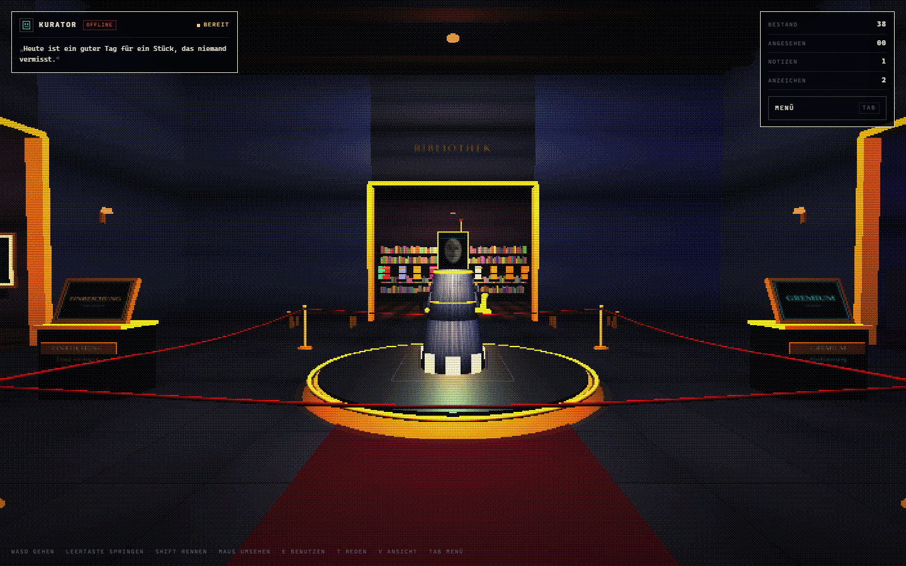

# DAS ARCHIV

Ein begehbares Museum für deutsche Internetgeschichte — im Look eines alten Röhrenmonitors.
Du läufst durch die Räume, sicherst Exponate, stimmst über Neuaufnahmen ab und redest mit dem
Kurator. Der ist keine Kulisse: er geht durch das Haus, denkt laut und sucht selbst nach Stücken.

**Repository:** <https://github.com/Todeskreuzz/das-archiv>



---

## Bildsprache

Kein Hochglanz. Das Bild wird bei 460 Pixel Höhe gerendert, mit geordnetem Dithering auf fünf
Farbstufen reduziert, mit Scanlines und kaltem Gegenlicht überzogen und dann hochskaliert.
Die Oberfläche ist 1-Bit: schwarz, Papierweiß, ein Bernstein-Akzent, dünne Linien, Monospace.

Kein Zeitlimit, keine Saison. Das hier ist ein Langzeitprojekt.

---

## Was gerade geht

| Bereich | Status |
| --- | --- |
| Begehbare 3D-Welt (First Person) | fertig |
| Springen, Rennen mit Sprint-Animation | fertig |
| Dritte Person mit sichtbarer Figur (`V`) | fertig |
| Vier Räume: Halle, Galerie, Spielhalle, Bibliothek | fertig |
| 38 Exponate mit eigenen Kurator-Texten | fertig |
| Zielscan mit Katalogzettel statt Rahmen | fertig |
| Sichern ohne Punkte, ohne Ränge | fertig |
| Notizen und Wandzeichnungen, für alle sichtbar | fertig |
| Gremium: Abstimmung mit Quorum und Kurator-Votum | fertig |
| Nominieren mit sofortigem Urteil (0–100) | fertig |
| **Kurator läuft selbstständig durch das Haus** | fertig |
| **Brücke: die KI lebt im Server, nicht im Browser** | fertig |
| **Persona-Datei: der Kurator hat ein Gedächtnis** | fertig |
| **Scanner: durchsucht das Netz selbst** | fertig |
| **Depot: alle Stücke als Kisten, dazu ein Katalog** | fertig |
| **Notizen an jeder Wand** | fertig |
| **Tunnel als sichtbare Verbindung, begehbar** | fertig |
| **Jedes Objekt im Haus ist anfassbar** | fertig |
| **Kurator denkt laut (Gedanken im HUD)** | fertig |
| **Gespräch über ein Textfenster** | fertig |
| **Kurator findet selbst neue Stücke** | fertig |
| Menü mit Bestand, Protokoll, Über, Anonymität, Konto | fertig |
| Speicherung im Browser, kein Konto | fertig |
| Touch-Steuerung (Joystick + Wischen) | grundlegend |

---

## Schnellstart

**Windows:** `website\Start-Vorschau.bat` doppelklicken.

**Manuell:**

```powershell
cd "Archive Game\website"
node scripts/bridge.mjs
```

Dann <http://localhost:4780> öffnen. Kein Build, kein `npm install`, keine Internetverbindung nötig.

**Live-Modus (echtes Sprachmodell):** Die Brücke spricht mit einer OpenAI-kompatiblen API, wenn ein
Schlüssel gesetzt ist. Ohne Schlüssel denkt sie selbst — dieselbe Persona, nur ohne Netz.

```powershell
$env:ARCHIV_API_KEY = "sk-..."
$env:ARCHIV_MODEL   = "gpt-4o-mini"            # optional
$env:ARCHIV_BASE_URL = "https://api.openai.com/v1"
node scripts/bridge.mjs
```

**Alle vier Anbieter sind vorbereitet.** Die Brücke liest `website/.env`; die Vorlage liegt daneben.

```powershell
cd "Archive Game\website"
Copy-Item .env.example .env
notepad .env
```

Dann in `.env` einen Anbieter wählen und den Schlüssel eintragen:

```
ARCHIV_PROVIDER=gemini
GEMINI_API_KEY=dein-schluessel
```

Prüfen, was erreichbar ist:

```powershell
node scripts/check-providers.mjs
```

| Anbieter | Schlüssel | Standardmodell | Konto |
| --- | --- | --- | --- |
| Google Gemini | `GEMINI_API_KEY` | `gemini-2.0-flash` | aistudio.google.com/apikey |
| Groq | `GROQ_API_KEY` | `llama-3.3-70b-versatile` | console.groq.com/keys |
| OpenRouter | `OPENROUTER_API_KEY` | `meta-llama/llama-3.3-70b-instruct:free` | openrouter.ai/keys |
| Cloudflare Workers AI | `CLOUDFLARE_API_TOKEN` + `CLOUDFLARE_ACCOUNT_ID` | `@cf/meta/llama-3.3-70b-instruct-fp8-fast` | dash.cloudflare.com/profile/api-tokens |

Ohne `ARCHIV_PROVIDER` nimmt die Brücke den ersten Anbieter mit Schlüssel. `ARCHIV_MODEL`
überschreibt jedes Standardmodell.

Die freien Kontingente sind begrenzt und ändern sich. Dauerhaft kostenlos und ohne Limit ist nur
ein eigener Server mit Ollama (z. B. Oracle Cloud „Always Free"): `ARCHIV_BASE_URL=http://localhost:11434/v1`.

Im HUD steht dann `LIVE` statt `LOKAL`. Der Tunnel unten im Haus zeigt denselben Zustand.
Das Menü hat einen Eintrag **Verbindung**, der Zustand, Modell und alle vier Anbieter anzeigt.

| Taste | Wirkung |
| --- | --- |
| `W A S D` | gehen |
| `Leertaste` | springen |
| `Shift` | rennen — schneller, mit weiterem Schritt und Zug im Bild |
| Maus | umsehen (Klick sperrt den Zeiger, Ziehen funktioniert auch ohne) |
| `E` | Exponat ansehen · Objekt untersuchen · Wand beschreiben |
| `M` | Notizfläche an die Wand vor dir heften |
| `T` | mit dem Kurator reden |
| `V` | erste / dritte Person |
| `Tab` | Menü |
| `Esc` | Panel schließen, Zeiger freigeben, Menü |

---

## Der Kurator

### Wie er aussieht

- **Mantel** aus Punktmatrix-Stoff, unten in einzelne Papierbahnen ausgefranst.
- **Kopf** ist ein Bildschirm im Messingrahmen: ein grob gerastertes Porträt, das alle paar
  Sekunden die Miene wechselt und blinzelt.
- **Scanzeile** wandert über das Porträt; beim Sprechen wird sie heller.
- **Stempel** in der rechten Hand. Fällt ein Urteil, schlägt er zu.
- **Bodenrahmen** aus vier Strichen — dieselbe Sprache wie der Zielscan.

### Was er tut

Er steht nicht herum. Er läuft eine Runde durch das Haus — Halle, Galerie, Bibliothek,
Spielhalle — bleibt vor Exponaten stehen, dreht den Kopf und teilt alle 15 bis 30 Sekunden
einen Gedanken im HUD. Alle ein bis drei Minuten findet er selbst ein Stück und legt es dem
Gremium vor. Wenn du in seiner Nähe bist, dreht er sich zu dir.

### Wie du mit ihm redest

`T` öffnet ein Terminalfenster. Du kannst tippen, was du willst; er antwortet aus dem Zustand
des Hauses: nach einem Exponat fragen, nach dem Bestand, nach dem Bestand, nach seiner Meinung.
Er kann dich zu einem Stück führen, dir die Abstimmung öffnen oder sofort etwas suchen.

Das ist **kein Sprachmodell**. Die Antworten entstehen aus Absichten und dem echten Spielstand —
er sagt auch, wenn er etwas nicht weiß. Die Schnittstelle (`src/ai/dialogue.js`) ist so gebaut,
dass später ein Modell dahinter kann, ohne die Oberfläche zu ändern.

---

## Die Verbindung

Der Browser entscheidet nichts mehr. Beim Start öffnet er eine Leitung zu `scripts/bridge.mjs`.
Die Brücke hält den Zustand, denkt, sucht und schickt Ereignisse zurück:

| Ereignis | Wirkung |
| --- | --- |
| `thought` | ein Satz im HUD |
| `go` | ein Raum, in den der Kurator geht |
| `find` | ein neues Stück für das Gremium |
| `status` | LIVE / LOKAL / OFFLINE |

Ohne Schlüssel denkt die Brücke selbst — dieselben Sätze, dieselbe Auswahl, nur ohne Netz.
Mit `ARCHIV_API_KEY` antwortet ein Sprachmodell: Gedanken, Wege und Antworten kommen dann aus
dem Modell, nicht aus einer Tabelle. Fällt die Leitung aus, übernimmt der lokale Notbetrieb
und das HUD zeigt `OFFLINE`.

### Der Tunnel

Hinter der Bibliothek führt eine Stahltür in einen Gang: Beton, Kabeltrassen, Neonröhren.
Am Ende liegt der **Verbindungskern** und ein Terminal, das den Zustand der Leitung anzeigt.
Der Kurator geht regelmäßig hinunter. Es ist der einzige Ort im Haus, an dem man sieht,
woher er kommt.

### Wie die KI wirklich ins Spiel kommt

Eine laufende Unterhaltung wie diese kann nicht dauerhaft im Spiel sitzen — sie hat keinen
Prozess, kein Gedächtnis und keinen Ort, an dem sie auf Anfragen wartet. Was geht:

1. Die Brücke hält die Verbindung und schickt bei jeder Frage den Spielstand mit.
2. `persona/curator.md` enthält Charakter, Wissen und Regeln. Diese Datei wird bei **jeder**
   Anfrage mitgeschickt. Sie ist das Gedächtnis, das ein Modell sonst nicht hat.
3. Mit `ARCHIV_API_KEY` antwortet ein echtes Sprachmodell — in derselben Stimme, mit demselben
   Gedächtnis, bei jeder Frage neu.
4. Ohne Schlüssel antwortet die Brücke selbst mit derselben Persona. Der Unterschied ist die
   Qualität, nicht die Figur.

**Kostenlos:** Ein lokales Modell über Ollama oder LM Studio. `ARCHIV_BASE_URL=http://localhost:11434/v1`
und `ARCHIV_MODEL=llama3.1` — dann läuft alles auf deinem Rechner, ohne Rechnung.

### Der Scanner

Alle 90 Sekunden schickt die Brücke den Scout los. Er besucht deutsche Seiten, liest
`robots.txt`, holt Titel, Beschreibung und den ersten Absatz, verwirft Doppelungen und
bewertet den Fund. Ab 48 Punkten wird daraus ein Kandidat für das Gremium.

Ohne Schlüssel schreibt er die Beschreibung selbst. Mit Schlüssel darf das Modell sie
formulieren — in der Stimme des Kurators.

Startseiten: Wikipedia-Artikel zu Moorhuhn, StudiVZ, BTX, Krautchan, Netzpolitik, dazu
heise.de, netzpolitik.org und Fefes Blog. Von dort folgt er Links bis Tiefe 2, nur auf
`.de`, `.at`, `.ch`, `.org`, `.net`, `.com`.

### Das Depot

Hinter dem Verbindungsraum liegt eine Halle mit vier Regalreihen. Jedes Stück im Bestand
steht dort als Kiste, farbig nach Raum. Am Eingang ein Katalogscreen: `E` öffnet die
vollständige Liste mit Suche und Sprung zum Exponat.

### Notizen überall

`M` heftet eine Notizfläche an die Wand vor dir — überall im Haus, nicht nur an den sechs
freien Wänden. Die Fläche hat ihre eigene Leinwand: schreiben, zeichnen, speichern.
Sie bleibt, wo du sie hingehängt hast.

---

## Interaktion

Kein Auswahlrahmen. Zielst du auf ein Exponat, laufen zwei dünne Messlinien an den Rändern,
eine Scanzeile fährt darüber, und darunter hängt ein **Katalogzettel** mit gestanztem Loch:
Titel, Jahr, Seltenheit und die Taste.

An sechs freien Wänden im Haus öffnet `E` stattdessen die **Wandtafel**: eine Leinwand zum
Zeichnen, vier Stifte, ein Feld für Notizen. Was du speicherst, geht an die Brücke, wird auf
der Wand als Textur gezeichnet und ist für alle sichtbar, die später hereinkommen.

---

## Keine Punkte

Es gibt keinen Punktestand, keine Ränge, keine Aufträge. Ein Archiv belohnt nichts —
es bewahrt auf. Der einzige Zähler ist „angesehen": wie viele der Stücke du dir wirklich
angesehen hast. Mehr nicht.

---

## Projektstruktur

```
Archive Game/
├─ README.md
├─ docs/
│  ├─ DESIGN.md                  ← Bildsprache, Welt, Avatar, Technik
│  ├─ ROADMAP.md                 ← was als Nächstes kommt
│  └─ screenshots/
└─ website/
   ├─ index.html                 ← HUD, Menü, Chat, Panels
   ├─ Start-Vorschau.bat
   ├─ package.json
   ├─ vendor/three.module.js
   ├─ scripts/
   │  ├─ bridge.mjs              ← Server, Leitung, Wände, Persona
   │  └─ scout.mjs              ← der Internet-Scanner
   ├─ persona/
   │  └─ curator.md             ← Charakter und Gedächtnis des Kurators
   ├─ styles/
   │  ├─ base.css                ← 1-Bit-Raster, Panels, Formulare
   │  └─ world.css               ← Bühne, HUD, Zielscan, Chat
   ├─ src/
   │  ├─ main.js                 ← Start, Renderer, Interaktion, Schleife
   │  ├─ logic.js                ← reine Spiellogik (testbar, ohne DOM)
   │  ├─ curator.js              ← Urteile und Formulierungen
   │  ├─ state.js                ← Zustand + localStorage
   │  ├─ ai/
   │  │  ├─ agent.js             ← laufen, stehen, schauen
   │  │  ├─ link.js              ← Leitung zur Brücke (SSE)
   │  │  ├─ dialogue.js          ← Gesprächsabsichten (Notbetrieb)
   │  │  └─ research.js          ← Fundbestand für die eigene Suche
   │  ├─ data/
   │  │  ├─ seed.js              ← 38 Exponate + 4 Kandidaten
   │  │  ├─ props.js             ← Texte für jedes Objekt im Haus
   │  │  └─ art.js               ← generierte Poster (SVG)
   │  ├─ engine/
   │  │  ├─ world.js             ← Gebäude, Platzierung, Licht
   │  │  ├─ builder.js           ← Geometrie, Kollision, Materialien
   │  │  ├─ post.js              ← Dithering, Farbstufen, Scanlines
   │  │  ├─ textures.js          ← Canvas- und SVG-Texturen
   │  │  ├─ curator-npc.js       ← mein Avatar
   │  │  ├─ visitor.js           ← Spielfigur für die dritte Person
   │  │  └─ player.js            ← First-Person-Steuerung, Sprung, Sprint
   │  └─ ui/
   │     ├─ hud.js               ← Bestand, Zielscan, Zitate
   │     ├─ menu.js
   │     ├─ chat.js              ← Gesprächsfenster
   │     └─ panels.js            ← Exponat, Gremium, Nominieren, Protokoll
   └─ tests/logic.test.mjs       ← 20 Tests
```

---

## Räume

| Raum | Maße | Inhalt |
| --- | --- | --- |
| **Halle** | 20 × 16 m | Podest, zwei Terminals, Bänke, Teppich |
| **Galerie** (Westen) | 12 × 12 m | 12 gerahmte Grafiken |
| **Spielhalle** (Osten) | 12 × 12 m | 9 Automaten |
| **Bibliothek** (Norden) | 20 × 10 m | 17 Bände in Regalen |

Grundriss mit Koordinaten: [`docs/DESIGN.md`](docs/DESIGN.md).

---

## Spielschleife

1. **Umsehen.** Jedes Exponat hat einen eigenen Text.
2. **Sichern.** Ein Stück ansehen und als gesichert vermerken. Ohne Belohnung, ohne Punktestand.
3. **Aufschreiben.** An sechs Wänden kannst du Notizen und Zeichnungen hinterlassen — für alle sichtbar.
4. **Abstimmen.** Am GREMIUM-Terminal entscheidet das Quorum von fünf Netto-Stimmen.
   Die Stimme des Kurators zählt doppelt.
5. **Nominieren.** Am EINREICHUNG-Terminal prüft der Kurator sofort: Note 0–100, Begründung, Urteil.
6. **Zuhören.** Seine Funde landen automatisch beim Gremium — du entscheidest, ob sie bleiben.

Gespeichert wird lokal unter `das-archiv.v2`. Notizen und Wandzeichnungen liegen auf dem
Brückenserver in `website/data/graffiti.json` und sind für alle sichtbar.

---

## Tests

```powershell
cd "Archive Game\website"
node --test tests/logic.test.mjs
```

Erwartet: **20 Tests, 20 bestanden.**

---

## Inhalt und Haltung

Die Exponate sind echte Phänomene — Fefes Blog, Moorhuhn, StudiVZ, BTX, die AOL-CD.
Die Texte sind eigene Formulierungen, keine kopierten Artikel. Jahreszahlen sind gerundet;
wo etwas umstritten ist, steht es im Text.

Das Archiv kopiert keine fremden Seiten. Es beschreibt sie, verlinkt sie und bewahrt ihre
Geschichte — nicht ihren Quellcode.

Die Sprache im Spiel ist neutral. Keine Anreden, die jemanden ausschließen.

---

## Nächste Schritte

[`docs/ROADMAP.md`](docs/ROADMAP.md) — Ton, mehr Exponate, spielbarer Automat, echtes Sprachmodell,
gemeinsames Gremium.
